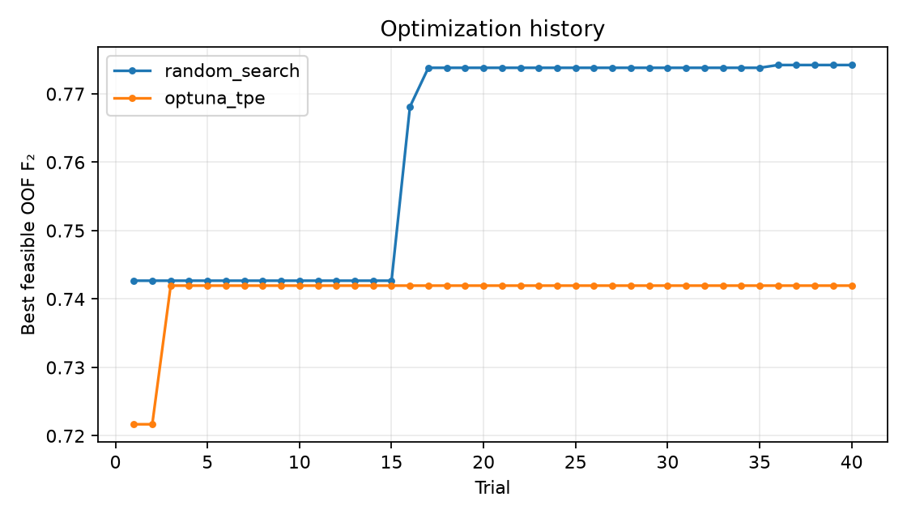

# Tối ưu Random Forest phát hiện lỗi máy có ràng buộc

Đồ án môn **Nhập môn Tối ưu hóa**: lựa chọn siêu tham số Random Forest và ngưỡng cảnh báo để phát hiện lỗi máy trên AI4I 2020, đồng thời kiểm soát cảnh báo sai, kích thước mô hình và độ trễ suy luận.

## Đặt vấn đề

Phát hiện nhãn `Machine failure=1` tại **thời điểm quan sát hiện tại** bằng các phép đo đã có lúc đó. Đồ án ưu tiên khả năng phát hiện lỗi thông qua F₂, đồng thời giới hạn cảnh báo sai và tài nguyên sử dụng. Các giới hạn FPR 5%, kích thước 20 MB và tỷ số độ trễ 1.25× là giả định của môn học, chưa phải yêu cầu được xác nhận từ một nhà máy. Bài toán chưa dự báo máy sẽ hỏng sau một khoảng thời gian trong tương lai.

## Mô hình hóa bài toán tối ưu

Biến quyết định là $(\lambda,\tau)$, gồm sáu siêu tham số Random Forest (`n_estimators`, `max_depth`, `min_samples_split`, `min_samples_leaf`, `max_features`, `class_weight`) và ngưỡng cảnh báo $\tau\in[0,1]$.

Với mỗi cấu hình, các phần chia kiểm định chéo phân tầng cố định tạo ra một xác suất ngoài fold (**OOF — out-of-fold**) cho mỗi hàng của tập phát triển. Mỗi hàng được dự đoán bằng mô hình không huấn luyện trên chính hàng đó. Mục tiêu:

$$\max_{\lambda,\tau} F_2=\frac{5TP}{5TP+4FN+FP}$$

với các ràng buộc:

- Tỷ lệ cảnh báo sai $FPR=FP/(FP+TN)\le0.05$ trên dự đoán OOF.
- Kích thước mô hình lớn nhất trong các fold không vượt **20 MB**, tính theo hệ thập phân và lưu `joblib` không nén.
- Trung vị các tỷ số độ trễ đo ghép cặp so với Random Forest mặc định không vượt **1.25×**.

`TP`, `FP`, `FN`, `TN` lần lượt là số lỗi được phát hiện đúng, số cảnh báo sai, số lỗi bị bỏ sót và số trường hợp bình thường được nhận diện đúng. **Recall** là độ bao phủ các trường hợp lỗi; **Precision** là tỷ lệ lỗi thật trong các cảnh báo; **Accuracy** là tỷ lệ dự đoán đúng trên toàn bộ mẫu.

`config.json` quy định miền tìm kiếm và ngân sách **40 lượt thử cho mỗi phương pháp**. Tìm kiếm ngưỡng xét mọi giá trị xác suất OOF phân biệt, cùng ngưỡng không phát cảnh báo khi tồn tại. Các mức FPR 1% và 2% được dùng riêng để phân tích độ nhạy; không tự nới ràng buộc khi không tìm được nghiệm.

## Dữ liệu

Sử dụng [UCI AI4I 2020 Predictive Maintenance Dataset](https://archive.ics.uci.edu/dataset/601/ai4i%2B2020%2Bpredictive%2Bmaintenance%2Bdataset), DOI [10.24432/C5HS5C](https://doi.org/10.24432/C5HS5C), giấy phép **CC BY 4.0**. UCI mô tả đây là **dữ liệu tổng hợp**, được thiết kế để mô phỏng dữ liệu bảo trì công nghiệp.

CSV đi kèm có **10.000 hàng, 14 cột, 339 nhãn lỗi, 9.661 nhãn bình thường**, không có ô thiếu. Cột định danh là `UDI`. Có 27 hàng mà nhãn `Machine failure` khác phép OR của năm cờ nguyên nhân lỗi; đồ án giữ nguyên nhãn gốc.

Chỉ sáu trường sau được đưa vào tập đặc trưng `X`:

| Trường dữ liệu | Ý nghĩa |
|---|---|
| `Type` | Loại sản phẩm |
| `Air temperature [K]` | Nhiệt độ không khí |
| `Process temperature [K]` | Nhiệt độ quá trình |
| `Rotational speed [rpm]` | Tốc độ quay |
| `Torque [Nm]` | Mô-men xoắn |
| `Tool wear [min]` | Thời gian mòn dụng cụ |

Loại `UDI`, `Product ID`, `TWF`, `HDF`, `PWF`, `OSF`, `RNF` và `Machine failure` khỏi `X` để tránh đưa định danh, cờ nguyên nhân và nhãn vào đầu vào mô hình. SHA-256 và kết quả kiểm tra dữ liệu được lưu trong log. Phép chia tuần tự 70/15/15 khiến tập xác thực và tập kiểm tra không có HDF, nên chỉ dùng làm chẩn đoán.

## Phương pháp thực hiện

1. Tách riêng **20% dữ liệu làm tập kiểm tra (test)** bằng phép chia phân tầng, seed 42. Trên 80% còn lại — **tập phát triển (development)** — dùng cùng các chỉ số `StratifiedKFold(3)` có xáo trộn cho mọi mô hình cơ sở và lượt thử. Lưu đầy đủ chỉ số chia tập và fold.
2. Mã hóa one-hot cho `Type` trong pipeline huấn luyện của từng fold; giữ nguyên các trường số. Không dùng SMOTE.
3. So sánh **năm mô hình cơ sở (baseline)**: Dummy luôn chọn lớp phổ biến nhất; RF mặc định tại ngưỡng 0.5; RF cân bằng lớp tại ngưỡng 0.5; RF mặc định chọn ngưỡng từ OOF; RF cân bằng lớp chọn ngưỡng từ OOF. Cách so sánh này tách tác động của việc chỉnh ngưỡng khỏi tác động của việc đổi siêu tham số.
4. **Random Search** lấy mẫu đều trên các lựa chọn rời rạc; **Optuna TPE** sử dụng seed cố định. Hai phương pháp có cùng miền tìm kiếm, fold và ngân sách 40 lượt. TPE có 10 lượt khởi tạo. Lưu mọi lượt thử, kể cả nghiệm không khả thi.
5. Trong mỗi fold, đo cấu hình đang xét và RF mặc định trên cùng lô 256 hàng, một luồng CPU: 3 lượt làm nóng và 15 vòng ghép cặp, mỗi mô hình được gọi hai lần mỗi vòng. Luân phiên thứ tự `ứng viên–tham chiếu–tham chiếu–ứng viên` và thứ tự ngược lại. Trung vị của toàn bộ 45 tỷ số từ ba fold quyết định tính khả thi về độ trễ; lưu q25, q75, độ lệch tuyệt đối trung vị (MAD), trung vị từng fold và các phép đo thô. Kích thước là dung lượng `joblib` không nén lớn nhất trong các mô hình fold.
6. **Trước khi đánh giá test**, xếp các nghiệm OOF khả thi theo F₂ giảm dần, FPR tăng dần, kích thước tăng dần, tỷ số độ trễ tăng dần, rồi tên phương pháp và chỉ số lượt thử. Huấn luyện lại từng nghiệm không trùng trên toàn bộ tập phát triển theo thứ tự này. So với RF mặc định huấn luyện trên cùng tập bằng giao thức đo ghép cặp. Nếu vi phạm kích thước hoặc độ trễ thì thử nghiệm kế tiếp; nếu không có nghiệm đạt yêu cầu thì báo không khả thi và bỏ qua test. Chỉ đánh giá nghiệm huấn luyện lại khả thi đầu tiên trên test.
7. Khi đã chốt nghiệm, kiểm tra độ ổn định trên tập phát triển với các seed 42, 43 và 44. Thí nghiệm bổ sung đặc trưng thêm chênh lệch nhiệt độ, công suất cơ học và tích mô-men xoắn × thời gian mòn dụng cụ từ các trường cùng thời điểm; kết quả này không thay thế mô hình chính.

Việc vừa chỉnh ngưỡng OOF vừa so sánh nhiều lượt thử có thể làm điểm trên tập phát triển lạc quan. Average precision (**AP**) được báo như đại lượng tóm tắt PR-AUC không nội suy. Lịch sử pilot từng xem cùng tập test được công bố ở phần **Hạn chế**.

## Kết quả chính

Khối dưới đây được sinh trực tiếp từ `results/full` bằng `scripts/verify_results.py --write-readme`. Cùng script này đối chiếu nội dung với CSV, JSON, mô hình đã lưu và các giới hạn tài nguyên. Các số thập phân giữ dấu chấm như trong log để thuận tiện đối chiếu.

<!-- GENERATED_RESULTS_BEGIN -->
**Thực nghiệm chính thức:** 40 lượt Random Search + 40 lượt Optuna TPE, ba mô hình cơ sở có ngưỡng cố định và hai mô hình cơ sở chọn ngưỡng từ OOF. Số lượt tìm kiếm khả thi: Random Search 23, TPE 31.

| Cấu hình trên OOF của tập phát triển | F₂ | Recall | Precision | FPR | Ngưỡng |
|---|---:|---:|---:|---:|---:|
| Dummy: luôn chọn lớp phổ biến nhất | 0.0000 | 0.0000 | 0.0000 | 0.0000 | 0.5000 |
| RF mặc định, ngưỡng 0.5 | 0.5293 | 0.4797 | 0.9028 | 0.0018 | 0.5000 |
| RF cân bằng lớp, ngưỡng 0.5 | 0.6061 | 0.5904 | 0.6780 | 0.0098 | 0.5000 |
| RF mặc định, ngưỡng OOF | 0.7456 | 0.8155 | 0.5553 | 0.0229 | 0.2000 |
| RF cân bằng lớp, ngưỡng OOF | 0.7184 | 0.8192 | 0.4816 | 0.0309 | 0.2900 |
| Tốt nhất của Random Search (lượt #35) | 0.7742 | 0.8376 | 0.5942 | 0.0201 | 0.1977 |
| Tốt nhất của Optuna TPE (lượt #2) | 0.7420 | 0.8339 | 0.5148 | 0.0276 | 0.2277 |

Chỉ số lượt thử được đánh số từ 0, giống cột `trial` trong log.

Nghiệm cuối đã chốt thuộc **Random Search**, lượt **#35**, với `params_json={"class_weight": null, "max_depth": 12, "max_features": 0.75, "min_samples_leaf": 2, "min_samples_split": 10, "n_estimators": 100}` và ngưỡng **0.197739**. Trên OOF của tập phát triển, F₂ đạt **0.7742**, FPR **0.0201**. Phải chuyển sang nghiệm dự phòng sau khi huấn luyện lại: **Không**.
Hai phương pháp tìm được các nghiệm tốt nhất khác nhau trong lần chạy này; một ngân sách và một cách chia dữ liệu chưa chứng minh ưu thế tổng quát của phương pháp nào.

**Đánh giá trên tập kiểm tra sau khi chọn nghiệm chỉ bằng tập phát triển:** ma trận nhầm lẫn `[[1892, 40], [13, 55]]` (hàng là nhãn thực 0/1, cột là nhãn dự đoán 0/1). F₂ **0.7493**, độ bao phủ (Recall) **0.8088**, độ chính xác cảnh báo (Precision) **0.5789**, FPR **0.0207**, AP/PR-AUC **0.8408**, tỷ lệ dự đoán đúng (Accuracy) **0.9735**. Kích thước mô hình cuối không nén **1.117 MB** (giới hạn 20.0 MB); tỷ số độ trễ đo ghép cặp **0.951×** (giới hạn 1.25×), khoảng phân vị q25–q75 **0.898–1.017×**.




Xem [phân tích độ nhạy](results/full/sensitivity.csv), [độ ổn định](results/full/stability.csv), [thí nghiệm bổ sung đặc trưng](results/full/ablation.csv) và [các lần huấn luyện lại](results/full/refit_attempts.csv).
<!-- GENERATED_RESULTS_END -->

## Báo cáo và tài liệu bảo vệ

Bộ tài liệu cuối gồm **báo cáo 12 trang** ([Word chỉnh sửa được](report/bao_cao_do_an_ai4i.docx), [PDF](report/bao_cao_do_an_ai4i.pdf)) và **tóm tắt bảo vệ 1 trang** ([Word](report/tom_tat_bao_ve_1_trang.docx), [PDF](report/tom_tat_bao_ve_1_trang.pdf)). Báo cáo giữ motif bìa và bốn hình thực nghiệm từ tài liệu được cung cấp, đồng thời trình bày đủ bảy mục giảng viên yêu cầu.

Bìa tài liệu gốc ghi **Huỳnh Trí Minh — MSSV 24748020102035 — GVHD Nguyễn Thị Diễm Anh**. [Thông tin đối chiếu danh tính](report/identity.json) ghi rõ nguồn; báo cáo GitHub cũ chỉ có trường chờ điền, không có tên cụ thể mâu thuẫn. Chưa có mã lớp hoặc mã LMS trong tài liệu được cung cấp. Xem thêm [đối chiếu ZIP gốc](report/archive_comparison.md) và [bảng đối chiếu yêu cầu môn học](report/requirements_audit.md).

## Hướng dẫn chạy và kiểm chứng

Chạy các lệnh sau từ thư mục gốc của repo trên Windows PowerShell, với Python 3.14 và `uv`:

```powershell
uv --cache-dir .uv-cache venv --python 3.14 .venv
uv --cache-dir .uv-cache pip install --python .venv\Scripts\python.exe -r requirements.txt
.venv\Scripts\python.exe -m unittest discover -s tests -v
.venv\Scripts\python.exe scripts\verify_results.py
```

Hai lệnh cuối kiểm chứng thực nghiệm đã lưu mà không sửa file. Để chạy một thực nghiệm mới:

```powershell
.venv\Scripts\python.exe run.py
```

`run.py` có thể được gọi từ thư mục làm việc khác và mặc định tạo thư mục mới có dấu thời gian trong `results/runs/`; chương trình từ chối ghi vào thư mục đầu ra đã có nội dung. Giữ `results/full` làm thực nghiệm của bản nộp. Chạy thử chỉ trên tập phát triển bằng `.venv\Scripts\python.exe run.py --pilot --trials 2`; chế độ pilot hiện tại bỏ qua test. Chương trình hỗ trợ `--config`, `--data`, `--trials` và `--output-dir`; đường dẫn tương đối được tính từ gốc dự án. Thực nghiệm chính thức mất **1.396,24 giây**; phần cứng và tải hệ thống ảnh hưởng thời gian chạy lại.

### Tạo lại báo cáo

Nội dung nguồn có thể chỉnh trong `scripts/build_report.py`. Để tạo lại tài liệu từ thực nghiệm đã nộp, cài thêm thư viện báo cáo và dùng Microsoft Word trên Windows:

```powershell
uv --cache-dir .uv-cache pip install --python .venv\Scripts\python.exe -r requirements-report.txt
.venv\Scripts\python.exe scripts\build_report.py --results-dir results/full --output-dir report
powershell -NoProfile -File scripts\export_report.ps1
# Xem lại bố cục cả hai PDF trước khi ghi hash của nguồn và đầu ra thực tế.
.venv\Scripts\python.exe scripts\build_report.py --finalize-pdfs
.venv\Scripts\python.exe scripts\verify_results.py
```

Có thể xuất DOCX sang PDF bằng LibreOffice, nhưng cần kiểm tra riêng bố cục của bản xuất đó. Không cần tạo lại báo cáo để kiểm chứng kết quả đã lưu trong repo. Tùy chọn `--write-readme` chỉ tạo lại khối kết quả được đánh dấu sau khi kiểm tra dữ liệu; mặc định bộ kiểm chứng chỉ đọc file.

### Chính sách xuống dòng và hash

`.gitattributes` bắt buộc văn bản dùng LF, kể cả khi Windows đặt `core.autocrlf=true`. Hash CSV và JSON được tính trên byte thực tế; mọi sai lệch đều bị từ chối. [Bằng chứng chuyển đổi](data/eol_migration.json) ghi hash CSV cũ dùng CRLF và hash hiện tại dùng LF. Manifest giữ nguyên ngày chạy và thời gian thực nghiệm gốc; chỉ cập nhật thông tin đóng gói. [Metadata báo cáo](report/build_metadata.json) lưu hash của log, mô hình, hình ảnh, mã nguồn tạo báo cáo và bốn file DOCX/PDF. Khi nguồn hoặc báo cáo thay đổi, cần tạo lại tài liệu và metadata tương ứng.

### Tạo ZIP nộp bài

Từ bản làm việc đã commit và không có thay đổi chưa lưu, chạy:

```powershell
python scripts/package_submission.py --output-dir ../submission
```

Script dùng `git archive HEAD`, kiểm tra từng file trong ZIP với nội dung commit và ghi một danh sách kiểm kê SHA-256 riêng. ZIP nằm ngoài repo để tránh phải chứa chính bản thân nó trong commit. Có thể dùng **Code → Download ZIP** trên GitHub; để cố định bản nộp, nên tải theo một commit cụ thể.

### Môi trường thực nghiệm

`manifest.json` ghi phiên bản Python, thư viện, hệ điều hành/bộ xử lý, số luồng CPU, cách chia dữ liệu, seed và tổng thời gian chạy. Log gốc ghi CPU Intel64 Family 6 Model 154 Stepping 4 và Windows 11, nhưng không ghi tên thương mại CPU hay dung lượng RAM; không suy đoán các thông tin thiếu này. Phép kiểm tra độ ổn định chỉ đổi seed RF giữa 42/43/44, giữ nguyên fold và ngưỡng; đó không phải ba lần chạy độc lập toàn bộ thuật toán tìm kiếm.

## Cấu trúc kho mã nguồn

| Đường dẫn | Nội dung |
|---|---|
| `run.py`, `config.json`, `requirements.txt` | Điểm chạy chính, cấu hình/ngân sách và phiên bản thư viện cố định |
| `src/` | Kiểm tra dữ liệu, pipeline, đo độ trễ ghép cặp và thực nghiệm |
| `tests/` | Kiểm thử dữ liệu, tiền xử lý, chỉ số đánh giá, thời gian và chọn nghiệm dự phòng |
| `scripts/verify_results.py` | Đối chiếu tính nhất quán của kết quả, mô hình, báo cáo và README |
| `scripts/package_submission.py` | Đóng gói ZIP từ commit và kiểm tra từng file |
| `results/full/`, `results/pilot/` | Log và hình của thực nghiệm chính thức, lần chạy thử có nhãn rõ ràng |
| `report/` | Báo cáo DOCX/PDF 12 trang, tóm tắt DOCX/PDF 1 trang, hình nguồn và tài liệu đối chiếu |
| `ai4i+2020+predictive+maintenance+dataset/` | CSV UCI gốc có ghi nguồn |

Bản nộp không chứa ZIP gốc, môi trường `.venv*`, bộ nhớ đệm `.uv-cache` hoặc thông tin đăng nhập. Mô hình chính thức đã kiểm chứng có dung lượng khoảng **1,1 MB**, được lưu cùng kết quả CSV/JSON và hình để có thể tải và kiểm tra ngay sau khi clone. Các commit hoàn thiện ghi công việc thực tế tại thời điểm thực hiện; không giả tạo ngày trong quá khứ.

## Hạn chế

- Dữ liệu tổng hợp chưa chứng minh hiệu quả triển khai trên máy thật, khả năng dự báo lỗi tương lai, quan hệ nhân quả hoặc mức rủi ro đã được hiệu chỉnh.
- Chia ngẫu nhiên phân tầng đánh giá trên các hàng tương tự nhau, chưa kiểm tra tổng quát hóa theo thời gian, nhóm máy hoặc sự thay đổi phân bố dữ liệu. FPR trên tập phát triển không bảo đảm FPR trong tương lai.
- **Pilot của triển khai cũ từng xem cùng tập test** trước lần hoàn thiện này. Quy trình tìm kiếm hiện tại không dùng kết quả test của pilot để chọn cấu hình, nhưng lịch sử đó làm suy yếu nhận định test hoàn toàn mù. Chế độ pilot hiện tại bỏ qua test.
- Trung vị độ trễ đo ghép cặp giảm ảnh hưởng nhất thời của thứ tự chạy và tải nền, nhưng không loại bỏ sự phụ thuộc phần cứng. Các vòng đo thô và độ phân tán được giữ lại; nghiệm gần ranh giới độ trễ vẫn có thể đổi trạng thái khả thi khi đo lại.
- Dung lượng `joblib` không nén là đại lượng thay thế cho kích thước lưu trữ, không phải mức dùng RAM. Thời gian so sánh với ngưỡng không nằm trong phép đo `predict_proba`.
- Một cách chia dữ liệu và một ngân sách 40 lượt chưa chứng minh ưu thế tổng quát của optimizer nào. Kiểm định lồng nhau và dữ liệu độc lập sẽ cung cấp bằng chứng mạnh hơn.
- Sáu commit ban đầu đều ngày **09/11/2026**, chưa chứng minh tiến độ 5 tuần theo yêu cầu. Các commit hoàn thiện sau đó không thể bù lại bằng chứng lịch sử này. Không sửa ngày hoặc giả tạo kết quả.
- Việc nộp LMS, ghim repo trên hồ sơ GitHub, xác nhận thông tin hành chính và bảo vệ trực tiếp của sinh viên chưa được kiểm chứng bởi repo.

## Công cụ AI hỗ trợ

OpenAI Codex hỗ trợ rà soát mã nguồn, kiểm thử, biên soạn tài liệu và tạo các file kết quả từ log. Sinh viên chịu trách nhiệm đọc hiểu mã, tái lập thực nghiệm, xác nhận thông tin bìa và nguồn UCI, đồng thời giải thích mọi quyết định khi bảo vệ.
