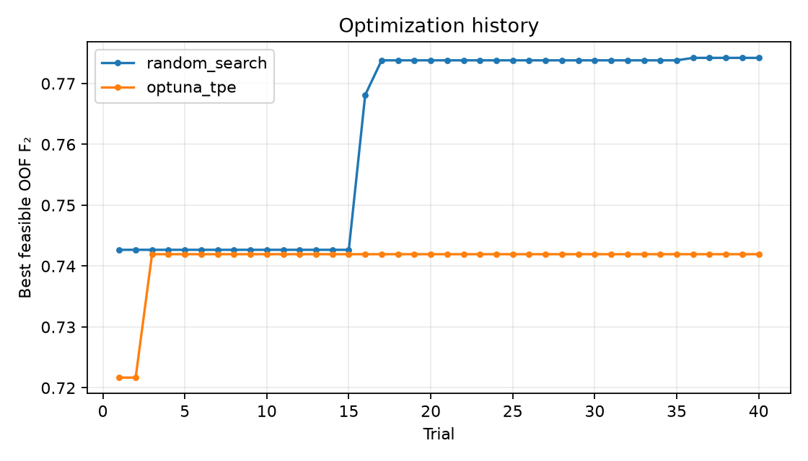
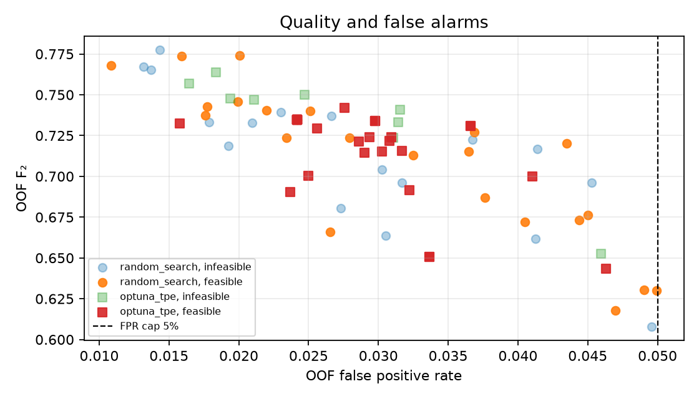

# Constrained Random Forest for current machine-failure detection

## Problem

Detect `Machine failure=1` at the **current AI4I observation** using measurements already available then. This project does not predict a future failure horizon. It prioritizes failure recall through F₂ while limiting false alerts, serialized size and inference time. The 5% FPR, 20 MB and 1.25× latency caps are coursework assumptions, not industrial requirements.

## Optimization Formulation

The decision is $(\lambda,\tau)$: six Random Forest hyperparameters (`n_estimators`, `max_depth`, `min_samples_split`, `min_samples_leaf`, `max_features`, `class_weight`) and alert threshold $\tau\in[0,1]$. For each configuration, fixed stratified folds produce one out-of-fold (OOF) probability per development row. We maximize $F_2=5TP/(5TP+4FN+FP)$ subject to $FPR=FP/(FP+TN)\le0.05$, largest fold model size $\le20$ decimal MB, and median paired latency ratio to default RF $\le1.25$. `config.json` defines the search space and 40 trials per method. The threshold search considers all distinct OOF scores and a no-alert threshold when possible. FPR caps 1% and 2% are separate sensitivity checks. No cap is silently loosened.

## Dataset

[UCI AI4I 2020 Predictive Maintenance Dataset](https://archive.ics.uci.edu/dataset/601/ai4i%2B2020%2Bpredictive%2Bmaintenance%2Bdataset), DOI [10.24432/C5HS5C](https://doi.org/10.24432/C5HS5C), CC BY 4.0. UCI describes the data as **synthetic** and designed to resemble industrial maintenance data. The supplied CSV has 10,000 rows, 14 columns, 339 failures, 9,661 nonfailures and no missing cells. Its identifier is `UDI`. The original `Machine failure` label differs from the OR of the five failure-mode flags in 27 rows; labels are retained.

Only `Type`, `Air temperature [K]`, `Process temperature [K]`, `Rotational speed [rpm]`, `Torque [Nm]` and `Tool wear [min]` enter `X`. `UDI`, `Product ID`, `TWF`, `HDF`, `PWF`, `OSF`, `RNF` and `Machine failure` are excluded. The CSV SHA-256 and audit are logged. A sequential 70/15/15 split would leave no HDF in validation or test, so it is a diagnostic only.

## Method

1. Lock a stratified 20% test split with seed 42. On the remaining 80%, use the same shuffled `StratifiedKFold(3)` assignments for every baseline and trial. Save split/fold indices.
2. One-hot encode `Type` within each fold's training pipeline; pass numerical fields through. No SMOTE is used.
3. Compare most-frequent Dummy, default RF at 0.5, balanced RF at 0.5, plus default and balanced RF with OOF-selected thresholds. This separates the effect of moving the threshold from changing hyperparameters.
4. Give uniform categorical Random Search and seeded Optuna TPE the same 40-trial budget, search space and folds. TPE has 10 startup trials. Log all trials, including infeasible ones.
5. For each fold, time the candidate and default RF on the same 256-row batch, one CPU thread: 3 warm-ups and 15 paired rounds of two calls per model. Alternate `candidate–reference–reference–candidate` with the reverse order. The median of all 45 fold-round ratios determines latency feasibility; q25, q75, MAD, fold medians and raw rounds are logged. Size is the largest uncompressed `joblib` fold-model size.
6. Rank OOF-feasible decisions before test access by F₂ descending, FPR ascending, size ascending, paired ratio ascending, method and trial. Refit each unique decision on all development rows in that order. Compare each refit with a full-development default RF under the same paired protocol. If one fails size or latency, try the next; if none passes, report no feasible refit and skip test. Evaluate only the first feasible refit on test.
7. With the decision fixed, check development-only stability on seeds 42, 43 and 44. An ablation adds temperature difference, mechanical power and torque × tool wear from current-observation fields; its result cannot replace the primary model.

OOF threshold tuning and many trial comparisons can make development scores optimistic. Average precision is the noninterpolated PR-AUC summary.

## Key Results

The block below is generated from `results/full` by `scripts/verify_results.py --write-readme`. The same script checks it against CSV, JSON, the saved model and resource caps.

<!-- GENERATED_RESULTS_BEGIN -->
**Official run:** 40 Random Search + 40 Optuna TPE trials, three fixed baselines and two OOF-threshold baselines. Feasible search trials: Random Search 23, TPE 31.

| Development OOF candidate | F₂ | Recall | Precision | FPR | Threshold |
|---|---:|---:|---:|---:|---:|
| dummy | 0.0000 | 0.0000 | 0.0000 | 0.0000 | 0.5000 |
| rf_default | 0.5293 | 0.4797 | 0.9028 | 0.0018 | 0.5000 |
| rf_balanced | 0.6061 | 0.5904 | 0.6780 | 0.0098 | 0.5000 |
| rf_default_oof_threshold | 0.7456 | 0.8155 | 0.5553 | 0.0229 | 0.2000 |
| rf_balanced_oof_threshold | 0.7184 | 0.8192 | 0.4816 | 0.0309 | 0.2900 |
| Best random_search (trial 35) | 0.7742 | 0.8376 | 0.5942 | 0.0201 | 0.1977 |
| Best optuna_tpe (trial 2) | 0.7420 | 0.8339 | 0.5148 | 0.0276 | 0.2277 |

The locked final decision came from **random_search**, trial **35**, with `params_json={"class_weight": null, "max_depth": 12, "max_features": 0.75, "min_samples_leaf": 2, "min_samples_split": 10, "n_estimators": 100}` and threshold **0.197739**. Development OOF F₂ was **0.7742**, FPR **0.0201**. Refit fallback used: **False**.
The methods found different best candidates in this run; one budget and one split do not establish general superiority.

**Held-out test, after development-only selection:** confusion matrix `[[1892, 40], [13, 55]]` (rows actual 0/1, columns predicted 0/1). F₂ **0.7493**, recall **0.8088**, precision **0.5789**, FPR **0.0207**, average precision/PR-AUC **0.8408**, accuracy **0.9735**. Final uncompressed size **1.117 MB** (limit 20.0 MB); paired latency ratio **0.951×** (limit 1.25×), with q25–q75 **0.898–1.017×**.





See [sensitivity](results/full/sensitivity.csv), [stability](results/full/stability.csv), [ablation](results/full/ablation.csv), and [refit attempts](results/full/refit_attempts.csv).
<!-- GENERATED_RESULTS_END -->

Read the [10-page report](report/bao_cao_do_an_ai4i.pdf), [one-page defense summary](report/tom_tat_bao_ve_1_trang.pdf), and [supplied ZIP versus official run comparison](report/archive_comparison.md). Identity, class, lecturer and LMS fields are explicitly marked `[CẦN ĐIỀN]` in the report.

## How to Run

On Windows PowerShell with Python 3.14 and `uv` (adjust the Python version if supported by the pinned packages):

```powershell
uv --cache-dir .uv-cache venv --python 3.14 .venv
uv --cache-dir .uv-cache pip install --python .venv\Scripts\python.exe -r requirements.txt
.venv\Scripts\python.exe -m unittest discover -s tests -v
.venv\Scripts\python.exe run.py
```

`run.py` works from any working directory and creates a fresh timestamped directory in `results/runs/` by default. To use a named official output, run `.venv\Scripts\python.exe run.py --output-dir results/full` only when that directory is empty. For a development-only pilot, use `.venv\Scripts\python.exe run.py --pilot --trials 2`; pilot skips test. `--config`, `--data`, `--trials` and `--output-dir` are supported. Relative paths resolve from the project root. Check a completed official run and update the README block with:

```powershell
.venv\Scripts\python.exe scripts\verify_results.py --results-dir results/full --write-readme
.venv\Scripts\python.exe scripts\verify_results.py --results-dir results/full
.venv\Scripts\python.exe scripts\build_report.py --results-dir results/full --output-dir report
```

`manifest.json` records Python, dependency versions, OS/processor, CPU setting, split, seed and wall time. Feasibility near the latency boundary may vary across CPUs and system load.

## Repository Structure

| Path | Contents |
|---|---|
| `run.py`, `config.json`, `requirements.txt` | Entry point, full budget, pinned environment |
| `src/` | Data audit, pipeline, paired timing and experiment |
| `tests/` | Dataset, preprocessing, metric, timing and fallback checks |
| `scripts/verify_results.py` | Artifact and README consistency check |
| `results/full/`, `results/pilot/` | Official and clearly labelled pilot logs/figures |
| `report/` | 10-page PDF report, one-page defense summary, ZIP comparison |
| `ai4i+2020+predictive+maintenance+dataset/` | Attributed original UCI CSV |

The raw ZIP, `.venv*`, `.uv-cache`, secrets, temporary files and other model binaries are excluded from Git. The verified official model is about 1.1 MB and is included with CSV/JSON results and figures, so the consistency check can load it after cloning. Commits in this reconstruction record real work done now; no historical dates are fabricated.

## Limitations

- Synthetic data do not establish real-machine deployment performance, future-failure prediction, causal relationships or calibrated risk.
- Random stratification tests similar rows, not temporal, machine-group or drift generalization. The development FPR cap does not guarantee future FPR.
- A previous implementation's pilot **did inspect this same held-out test** before this reconstruction. No choice in the new search is based on that pilot result, but this history weakens a strictly blind interpretation. The current pilot skips test.
- Paired median timing reduces transient order/load effects but cannot remove hardware dependence. Raw rounds and dispersion are retained; near-boundary feasibility may still vary.
- Uncompressed `joblib` bytes are a file-size proxy, not RAM usage. Threshold-comparison overhead is omitted from the timed `predict_proba` call.
- One split and one 40-trial budget do not establish general superiority of either optimizer. Nested evaluation and independent datasets would provide stronger evidence.

## AI assistance

OpenAI Codex assisted with code, tests, documentation and artifact generation. The student must inspect the source, reproduce the run, confirm UCI attribution and explain every decision during defense. Identity or LMS placeholders in the report require student input.
